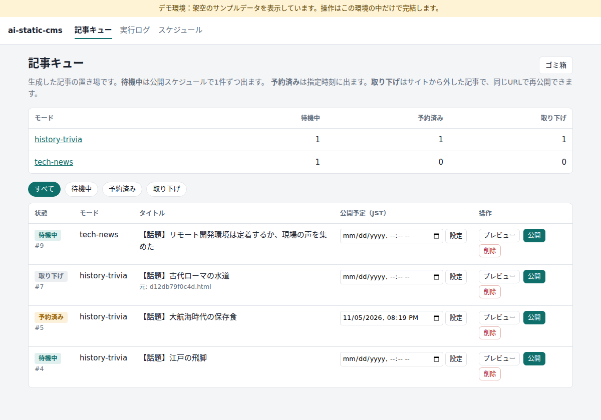
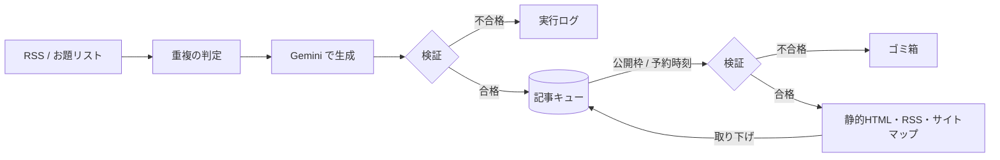
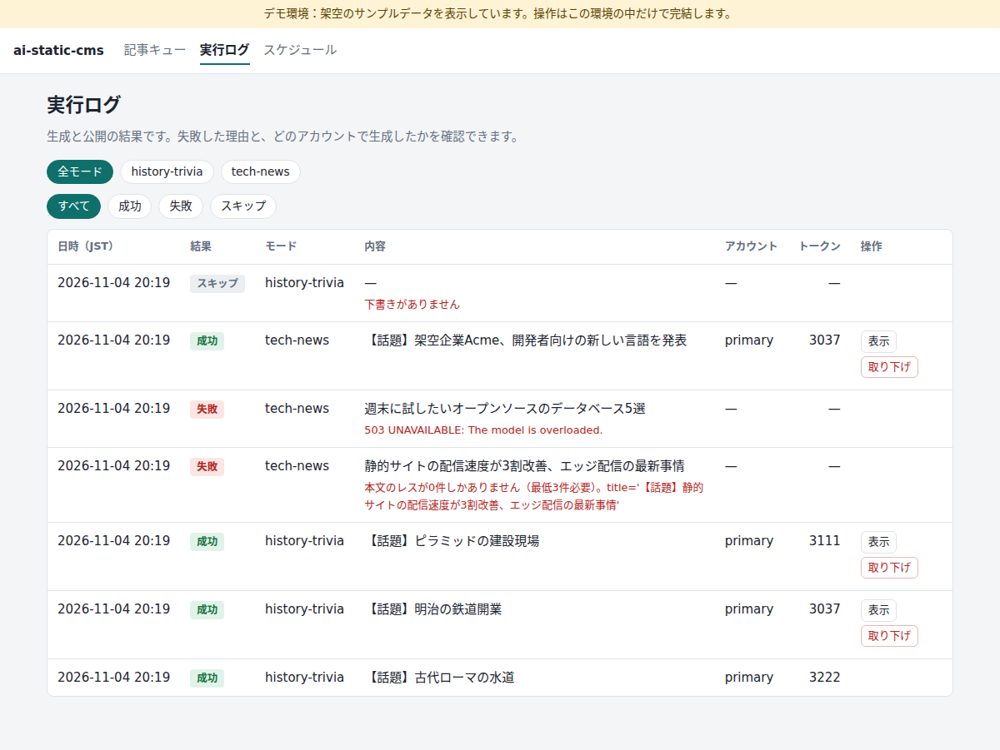
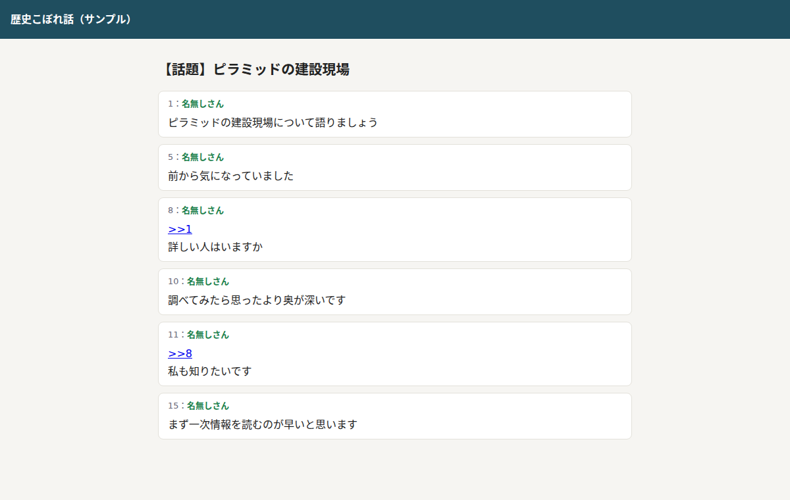

# ai-static-cms

AI で記事を生成し、検証・予約公開まで自動で行う静的サイト CMS です。

RSS やお題リストから記事を作り、キューに貯めて、決まった時刻に1本ずつ静的 HTML として公開します。
サイトの追加は TOML ファイルを1つ足すだけです。

このリポジトリは、個人で運用している本番システムの**中核部分を切り出して再構成したもの**です。

| 本番の運用規模 | |
|---|---|
| サイト数 | 11サイト（15モード）を並行運用 |
| 公開記事数 | 約17,000記事 |
| テスト | 本番 2,633件（このリポジトリには中核の132件を移植） |



## すぐ試す

API キーは要りません。[uv](https://docs.astral.sh/uv/) が入っていれば動きます。

```bash
uv sync
uv run cms demo        # 架空データを作って管理UIを起動
```

`http://127.0.0.1:5000/` を開きます。AI の応答だけを差し替えていて、検証・キュー・公開・ログは実際の処理を通ります。

```bash
uv run pytest          # テスト
```

## 全体の流れ



生成と公開を分けているのが一番の特徴です。AI が落ちている間も、在庫があれば公開は止まりません。

## 設計で工夫したこと

| 課題 | 対応 | 場所 |
|---|---|---|
| Gemini の 503 が続くと、その日の記事がゼロになる | 再試行＋別アカウントへの切り替え。失敗した日だけ、今日の残り公開枠の分を10分おきに作り直す | `ai.py`、`generate_retry.py` |
| AI の出力形式が毎回揺れる | 実際に受け取った崩れた形をテストに固定。未知の形でも、症状を検査して公開前に止める | `threads_maker.py`、`pipeline.py` |
| 壊れた下書きがキューの先頭に居座り、以後の公開がすべて失敗する | 公開できない記事はゴミ箱へ移して、次の記事へ進む | `pipeline.publish_or_trash` |
| 下書き・予約・取り下げで処理が分かれて複雑になる | 1つの状態機械にまとめた。取り下げは本文をキューへ戻すだけで、再公開は通常の公開処理を通る | `article_queue.py` |
| 設定の宣言と検証が二重になる | 各実装が設定項目を自己申告し、その宣言で TOML を検証する。typo には候補も出す | `schema.py`、`config.py` |

コメントには「いつ何が起きて、なぜこうしたか」を残しています。公開条件の閾値も、実際の記事の分布を測って決めました（`pipeline.py` の `MIN_THREAD_POSTS`）。

## 管理UI

| 画面 | 内容 |
|---|---|
| 記事キュー | 予約・即時公開・プレビュー・ゴミ箱 |
| 実行ログ | 成功・失敗の理由、使ったアカウント、トークン数、取り下げ |
| スケジュール | モードごとの生成・公開の時刻（読み取り専用） |



生成された記事はスレッド形式のページになります。



## 本番との違い

このリポジトリは説明用に範囲を絞っています。

- **管理UIは縮小版のモックです。** 本番の画面を3つに絞り、架空データで動かしています。認証が無いので `127.0.0.1` でのみ待ち受けます。
- **公開処理は最小限です。** 本番の公開処理（テーマ、構造化データ、広告など）は含めず、新しく書き直しました。
- **含めていない機能:** コメント欄（Cloudflare Workers + D1）、Cloudflare Pages へのデプロイ、SNS 投稿、監視、通知。
- **テストは AI の応答を差し替えて実行します。** 実際の Gemini API は呼びません。

## 実際に生成する

```bash
cp .env.example .env   # GEMINI_PRIMARY_API_KEY を設定
uv run cms generate history-trivia   # 生成してキューへ積む
uv run cms publish history-trivia    # 1本公開（output/ に出力）
uv run cms serve                     # 管理UI
uv run cms crontab                   # cron に登録する行を出力
```

`tech-news` は `modes/tech-news.toml` の `rss_url` がサンプル値なので、実在のフィードに変えてから使ってください。

## 構成

```
src/cms/
├── pipeline.py        生成から公開までの流れと検証
├── threads_maker.py   AI の応答を HTML へ変換
├── ai.py              Gemini 呼び出し（再試行・切り替え）
├── article_queue.py   記事キューの状態機械とゴミ箱
├── generate_retry.py  失敗した日の再試行の判定
├── publisher.py       静的ファイルの出力
├── schema.py          設定の宣言と検証
├── cli.py             コマンドライン
├── demo.py            デモ用の架空データ
└── admin/             管理UI（Flask）
modes/                 サイトごとの設定
prompts/  items/       プロンプトとお題
```

Python 3.12 / Flask / SQLite / google-genai
